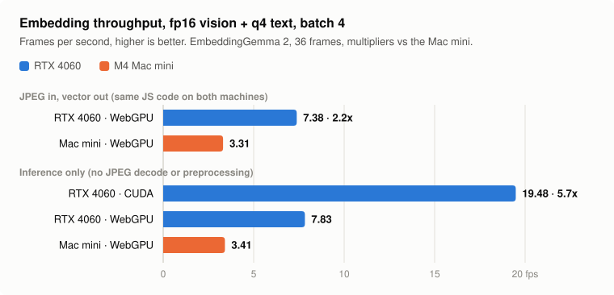
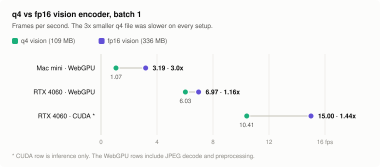

# RTX 4060 embedding benchmarks

I wanted to know if an RTX 4060 is any good for running embedding models locally. I searched and found zero real numbers, just spec sheets and guesses. So I measured it, with an M4 Mac mini next to it for comparison.

**TL;DR:**

- Same JavaScript code on both machines: the 4060 embeds images **2.2x faster** than the Mac mini (7.38 vs 3.31 frames/s).
- Native CUDA on the 4060: **5.7x** the Mac's inference speed (19.48 vs 3.41 frames/s, inference only).
- 8 GB of VRAM is way more than you need for this. The best config peaked at 2.7 GB.
- Use **fp16** weights, not q4. q4 was slower on both GPUs.

<picture>
  <source media="(prefers-color-scheme: dark)" srcset="charts/throughput-dark.svg">
  
</picture>

Tested October 2026. One model, small sample. Caveats at the bottom.

## What I ran

**Model:** [EmbeddingGemma 2](https://huggingface.co/onnx-community/embeddinggemma-2-ONNX) (`onnx-community/embeddinggemma-2-ONNX`). Google's small multimodal embedding model: a 170M param vision encoder plus a 270M param text model. Each image goes in, one 768-d vector comes out. Image budget was 140 tokens, which works out to 120 soft tokens (1,260 patches) for a 16:9 frame.

**Workload:** 36 JPEGs pulled from real video at 1 fps. A mix of talking heads, silent b-roll, drone shots and fast-cut edits. Max 768 px on the long side. Every run did 1 warmup pass, then 3 timed passes over all 36.

The images and model files were SHA-256 matched across both machines, so both boxes did the exact same work.

| | Mac mini | 4060 box |
|---|---|---|
| Chip | Apple M4, 10 cores | Ryzen 5 7600, 6C / 12T |
| RAM | 16 GB unified | 32 GB |
| GPU | Integrated M4 GPU | **Desktop** RTX 4060, 8 GB |
| OS | macOS 26.5 | Windows 10 Pro 19045, NVIDIA driver 610.88 |

**Software:**

- **JavaScript (both machines):** Bun 1.3.14 + Transformers.js 4.3.1 on the WebGPU backend. Identical code and lockfile.
- **CUDA (4060 only):** Python 3.12.5 + `onnxruntime-gpu` 1.26.0, with CUDA 12.9 and cuDNN 9 pulled in by pip.

## Results

### Same code, both machines (JPEG in, vector out)

This is the full per-image cost: JPEG decode, preprocessing, inference, and reading the vector back. It doesn't include model load time or pulling frames out of a video file.

The text model is q4 in every row. "Vision" is the precision of the vision encoder.

| Vision | Machine | Batch 1 | Batch 4 | Batch 8 |
|---|---|---:|---:|---:|
| q4 | Mac mini, CPU | 0.61 fps | | |
| q4 | Mac mini, WebGPU | 1.07 fps | | |
| q4 | 4060, WebGPU | 6.03 fps | 5.94 fps | 6.31 fps |
| fp16 | Mac mini, WebGPU | 3.19 fps | **3.31 fps** | 3.22 fps |
| fp16 | 4060, WebGPU | 6.97 fps | **7.38 fps** | 7.37 fps |

Best vs best: **7.38 / 3.31 = 2.23x** for the 4060.

If you compare both machines at q4 you get 5.6x, but that's mostly the Mac choking on q4. fp16 is the fair fight.

### Native CUDA on the 4060

For this one I exported the exact preprocessed tensors from the Mac, so both sides got byte-identical input. These numbers are **inference only**: no JPEG decode, no preprocessing. Host/GPU transfers and readback are included, and profiling was on.

| Vision | Batch 1 | Batch 4 | Batch 8 |
|---|---:|---:|---:|
| q4 | 10.41 fps | 12.10 fps | 12.17 fps |
| fp16 | 15.00 fps | **19.48 fps** | 19.32 fps |

The Mac's inference stage at the same config (fp16 vision, q4 text, batch 4) does 3.41 fps. So **19.48 / 3.41 = 5.72x**.

At batch 4 the vision encoder takes 45 ms per image and the text model takes 6 ms. The vision side is basically the whole cost.

### What that means in hours

At 1 fps, an hour of video is 3,600 frames.

| Setup | Per hour of footage | 100k images |
|---|---:|---:|
| Mac mini, WebGPU, fp16 | 18 min | 8.4 h |
| 4060, WebGPU, fp16 | 8 min | 3.8 h |
| 4060, CUDA, fp16 (inference only) | 3 min | 1.4 h |

The CUDA row is inference only. Decode + preprocessing measured about 7.6 ms per image on one JS thread. If you do that in series before inference, you'd land around 17 fps. If you prep on other cores while the GPU runs, you should stay close to 19. I haven't measured that end to end yet, so treat 17 to 19 as an estimate.

## Things I learned

**q4 is slower than fp16 on both GPUs.** Smaller file, slower run. On the Mac, switching the vision encoder from q4 to fp16 tripled throughput (1.07 → 3.19 fps). On CUDA, q4 → fp16 went from 12.1 to 19.5 fps at batch 4. My guess is that q4 weights get dequantized on the fly (ONNX's `MatMulNBits` op), so you pay compute to save memory you didn't need saved. The text model stayed q4 everywhere since it's only 6 ms of the 51.

<picture>
  <source media="(prefers-color-scheme: dark)" srcset="charts/q4-vs-fp16-dark.svg">
  
</picture>

**Batch 4 is the sweet spot.** Going from batch 1 to 4 helped on CUDA (15.0 → 19.5 fps). Batch 8 added nothing and used more VRAM (2.7 → 4.3 GB).

**8 GB of VRAM is plenty for a model this size.** The fp16 vision encoder plus q4 text model is about 510 MB of weights. Peak sampled VRAM was 2.7 GB on the best config and 4.8 GB on the worst one I tried (q4, batch 8).

**It stays cool, at least for short runs.** Temps were sampled every 2 s. The best CUDA run peaked at 58°C, and the hottest anything got was 66°C (WebGPU, fp16, batch 1). GPU utilization hit 96 to 100% at batch 4 and up. Power draw: the driver reported `N/A`, so I can't tell you watts or frames per joule.

**WebGPU leaves a lot on the table on NVIDIA.** Same GPU, same weights, same batch: the WebGPU inference stage did 7.8 fps, CUDA did 19.5. If you own a 4060, use CUDA.

**CUDA from JavaScript on Windows wasn't an option.** When I tested, the Windows build of `onnxruntime-node` shipped DirectML and WebGPU but no CUDA. So the CUDA runs are Python. It was painless, though. No system CUDA toolkit, no driver changes:

```powershell
python -m venv .venv-cuda
& ./.venv-cuda/Scripts/python.exe -m pip install "onnxruntime-gpu[cuda,cudnn]==1.26.0" numpy
```

Then call `ort.preload_dlls()` before creating a session, so it finds the CUDA DLLs inside the venv.

**Not everything runs on the GPU.** About 1.8% of node executions fell back to CPU in both the vision and text graphs. It didn't stop the 4060 from winning, but it's not a pure GPU run.

**Vectors match across machines.** With the same precision config, Mac WebGPU vs 4060 CUDA had a mean cosine of 0.99982 (min 0.99903). Mac vs 4060 at q4 on WebGPU was basically identical (mean above 0.9999999999). So you can embed half your library on the Mac and half on the 4060 and search them as one index.

**But don't mix precisions in one index.** In an earlier test, q4 vision + q4 text vs full fp32 was only 0.978 cosine. With this model, a good match and a bad match are often just ~0.07 apart, so that drift is enough to reshuffle results. Pick one config and re-embed if you switch.

**Mac notes:** Don't run this on the M4 CPU (0.61 fps). In an earlier test on an M4 MacBook, the CoreML backend was about 3.5x slower than plain CPU on the vision encoder, so skip that too. WebGPU with fp16 vision is the way.

## So what's the 4060 good for?

- **Bulk image or video frame embedding with small models (under ~1B params).** This is what I tested. 100k images in under 4 hours on WebGPU, ~1.4 hours of inference on CUDA.
- **A box on your LAN that does the embedding.** Send it frames, get vectors back, search on whatever machine you want. Since the vectors match, it doesn't matter which machine embedded what.
- **Running CUDA-only stuff at all.** A lot of ML tooling assumes NVIDIA, and CUDA doesn't exist on a Mac.

And the Mac mini? 3.3 fps is slower, but 100k images in 8.4 hours is still one night. If you already have one, it works. If you're buying something for bulk embedding, the 4060 is the faster option.

## What I didn't test

- LLMs, Whisper, OCR, or text-only embedding models
- The full video → frames → vectors → index pipeline
- Whether fp16 changes search quality (the vectors agree, but I didn't re-judge results)
- Long sustained jobs. Each timed run was short (about 8 s on CUDA, about 45 s on Mac fp16), so the temps above aren't long-run thermals
- Power usage
- The laptop 4060. It runs at a different power limit, so expect lower numbers

## Caveats

- **36 images is a small sample.** It's enough to compare relative speed. It's not a promise for your dataset.
- **The CUDA comparison is a different software stack** (Python + ONNX Runtime 1.26) than the JS runs. So 5.7x is "4060 + CUDA stack vs Mac + WebGPU stack", not pure hardware.
- **CUDA numbers had profiling on**, which adds a little overhead. The real number is probably slightly better.
- **One model.** Bigger models or different architectures will scale differently.
